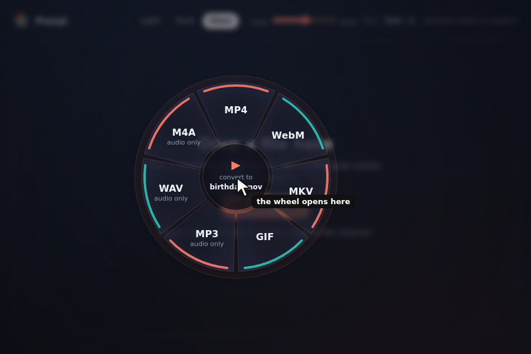

# Brixalo

A free desktop file converter with a radial wheel. Choose a file or drop it onto the app, then click an output format. Conversion runs on your computer using FFmpeg and ImageMagick.

**Early prototype, version 0.1.0.** Windows, macOS and Linux builds are configured in GitHub Actions. There is no published release yet. The app and installers are unsigned; expect operating-system warnings. Use copies of important files while testing.



## What it does

- Converts images, video and audio. Video can also be converted to audio only.
- Saves results beside the input, using a numbered name if the target name is already taken.
- Writes conversion output to a temporary file before moving it to the chosen destination.
- Includes Light, Dark and Glass themes, with free JSON theme add-ons.
- Has no account, telemetry or automatic update check. The app's source has offline checks and a restrictive connection policy. Installing dependencies and building require internet access.

| Input family | Output formats |
| --- | --- |
| Images | PNG, JPG, WebP, GIF, BMP, TIFF, AVIF |
| Video | MP4, WebM, MKV, GIF, MP3, WAV, M4A |
| Audio | MP3, WAV, FLAC, OGG, M4A, Opus |

The app hides the input's own format. Support depends on the codecs and delegates in your installed tools. PDF, office documents, batch conversion and system-wide drag shortcuts are not supported. The wheel opens inside the Brixalo window, not over other apps.

## Run from source

Install Node.js 20 or later, npm, Rust and the platform prerequisites for Tauri 2. Install FFmpeg and ImageMagick separately and make them available on `PATH`.

```sh
npm ci
npx tauri icon assets/icon.png
npx tauri dev
```

For an installer, run `npx tauri build` after the same setup. Linux also needs the WebKitGTK 4.1, GTK 3 and other native development packages listed in `.github/workflows/build.yml`. Windows needs the Tauri-required Microsoft C++ build tools; macOS needs Apple's command-line developer tools.

FFmpeg and ImageMagick are not bundled by this repository. Their licences and codec support are separate from Brixalo's source licence. Do not assume every FFmpeg build has the same licence or supported encoders.

## Use

1. Open Brixalo. Check that FFmpeg and ImageMagick are detected.
2. Click **Choose a file** or drop a file into the window.
3. Click a format on the wheel. The result appears next to the original.

Press **Esc** or click outside the wheel to close it. Tab and Enter also work. See the [user manual](docs/MANUAL.md) and [theme guide](docs/themes.md).

## Glass effects

Glass transparency and background blur depend on the operating system and compositor. The code requests Windows Mica/Acrylic, macOS vibrancy, or a Linux blur hint. Windows and macOS blur have not been visually verified. On Linux, a compositor may ignore the blur hint. The included screenshots illustrate the UI, not a guarantee of native blur on every desktop.

## Tests

```sh
npm test
```

This runs static offline checks and the conversion matrix. FFmpeg, FFprobe and ImageMagick are required. The matrix includes 62 checks for conversions, damaged files and output naming. CI also runs Rust file-safety tests and a Linux end-to-end conversion. Passing engine tests does not establish that every installer or desktop effect works on every machine.

## Origins

Radial menus for file conversion already exist. Brixalo does not claim to have invented that interaction. This is a separate Tauri/Rust and JavaScript implementation, not a Filee fork or plugin. Its name, icon, themes and source are maintained in this repository.

## Licence

Brixalo source is available under the [MIT License](LICENSE). You may use, modify, redistribute and sell it under those terms; there is no resale royalty. Third-party tools and dependencies keep their own licences.
