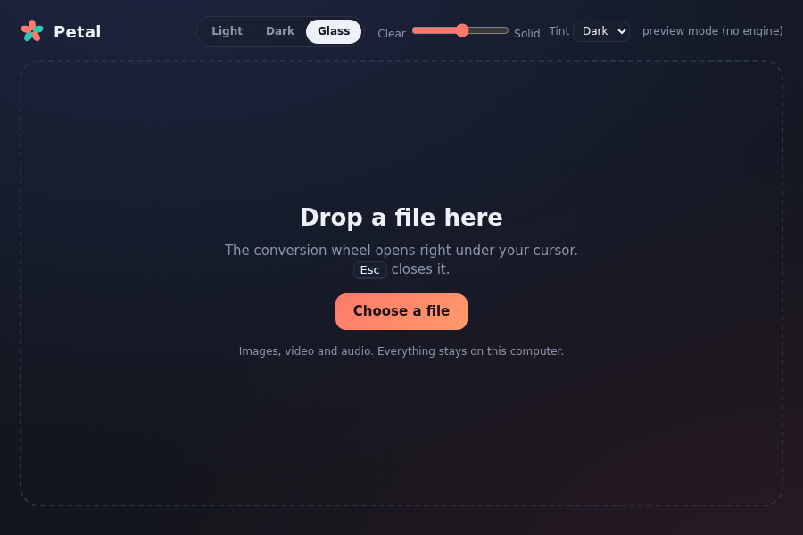
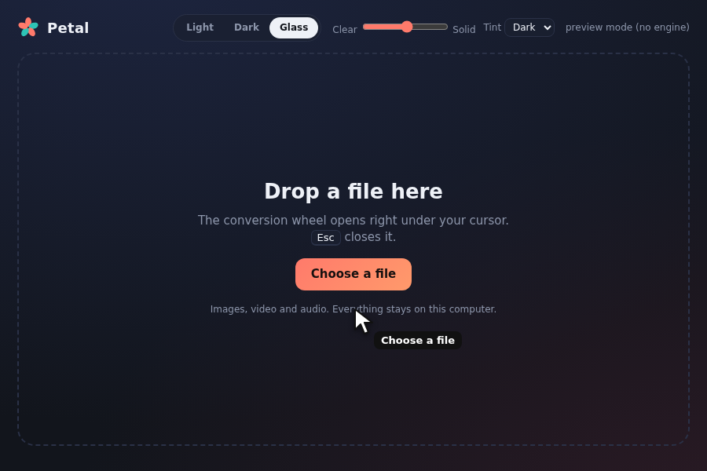
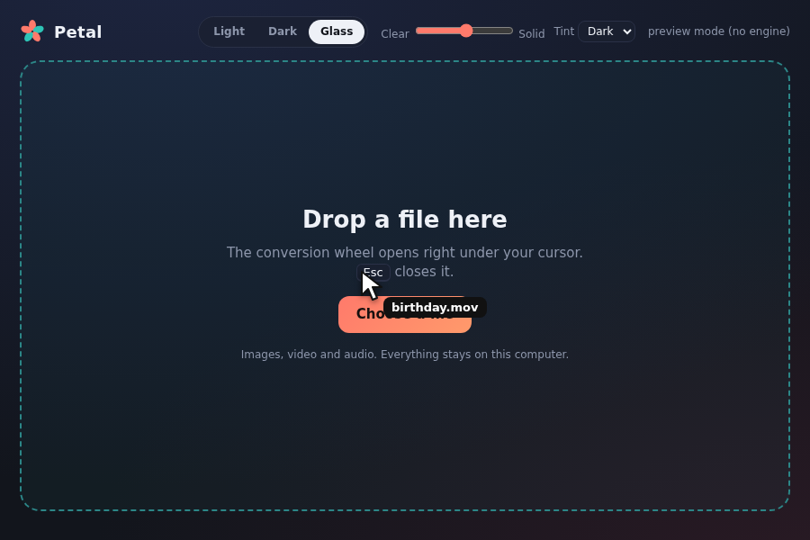
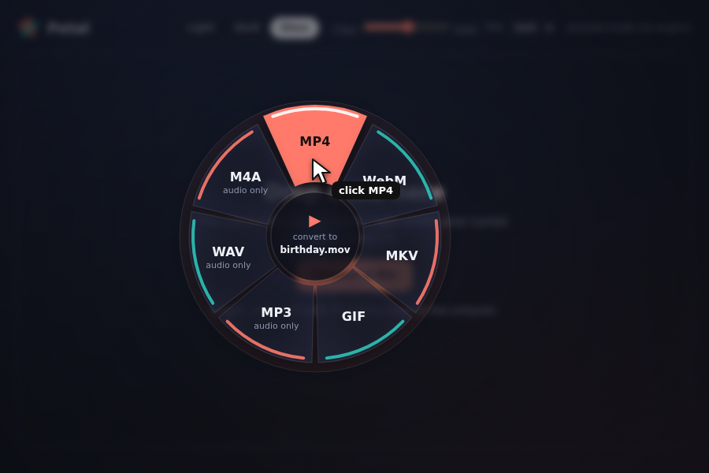
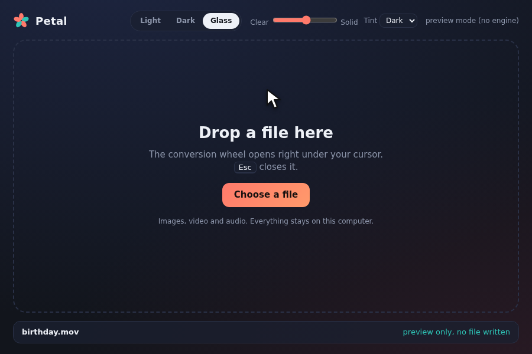
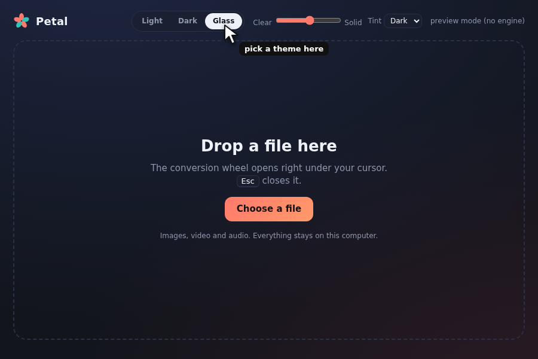
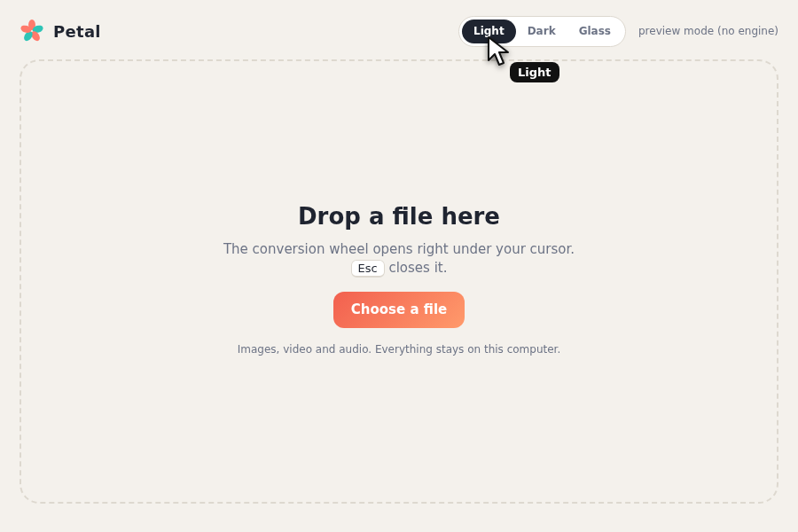
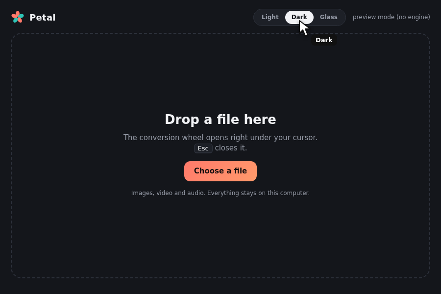
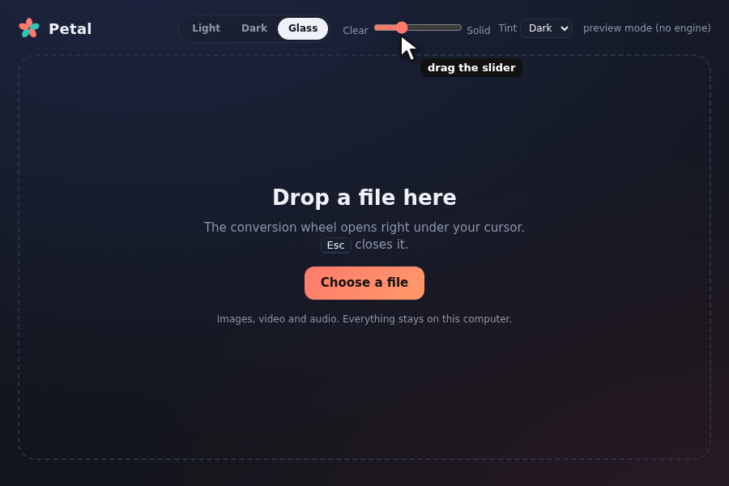
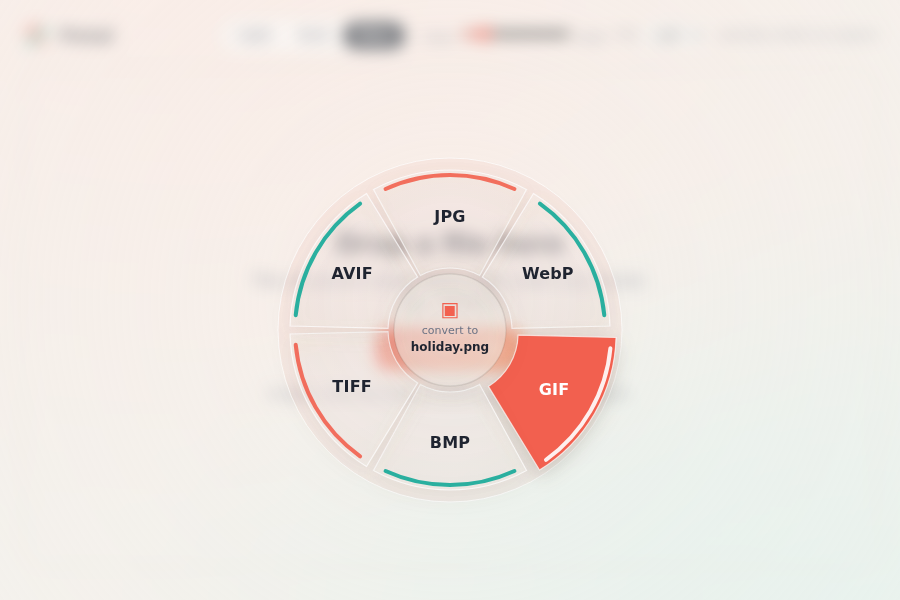

# Petal user manual

Petal converts pictures, videos and music. You drop a file, a wheel opens under your cursor, you click the format you want. That is the whole app. Nothing is uploaded: the conversion happens on your own computer.

## 1. Set up (one time, about 5 minutes)

**Step 1. Install Petal.** Download the installer for your computer and open it:
- Windows: the `.msi` or `-setup.exe` file
- Mac: the `.dmg` file. Drag Petal into Applications. The first time, right-click Petal and choose Open (Petal is not signed yet, so the Mac asks once).
- Linux: the `.deb` file (Ubuntu, Debian) or the `.AppImage` file (everything else)

**Step 2. Install the two helper tools.** Petal uses two free programs to do the real work, FFmpeg (video and audio) and ImageMagick (pictures).
- Windows: open the Start menu, type `cmd`, open it and run `winget install Gyan.FFmpeg ImageMagick.ImageMagick`
- Mac: install Homebrew from brew.sh, then run `brew install ffmpeg imagemagick`
- Linux (Ubuntu/Debian): run `sudo apt install ffmpeg imagemagick`

**Step 3. Open Petal.** The top right corner tells you if the helpers were found. Green text such as "FFmpeg + ImageMagick ready" means you are done. Red text names what is missing: install it and reopen Petal.

## 2. Convert a file

**Step 1. Give Petal a file.** Drag a file onto the window, or click **Choose a file**.

When you drag a file over the window, the box lights up to say "drop it here".

**Step 2. The wheel opens right where you let go of the file.** The middle shows the file name. Each petal is a format you can turn the file into. Petal leaves out the file's own format. Video files also get audio petals, so you can pull the sound out of a video.

**Step 3. Move over a petal and click it.** The petal lifts and lights up.

**Step 4. Done.** A line at the bottom says "saved" with the new file name. The new file is in the same folder as the original, with the same name and the new ending. Your original is never changed or replaced. If the name is taken, Petal adds (1), (2) and so on.

Tips: press **Esc** or click outside the wheel to close it. You can also use Tab and Enter instead of the mouse.

What Petal can convert today:

| You drop | Petal offers |
|---|---|
| Picture (png, jpg, webp, gif, bmp, tiff, avif, heic, ico) | PNG, JPG, WebP, GIF, BMP, TIFF, AVIF |
| Video (mp4, mov, mkv, webm, avi and more) | MP4, WebM, MKV, GIF, and audio only: MP3, WAV, M4A |
| Music (mp3, wav, flac, ogg, m4a, aac, opus) | MP3, WAV, FLAC, OGG, M4A, Opus |

If you drop something else, Petal says it cannot convert that type yet. PDF is not supported yet.

## 3. Make Petal look the way you like

Use the switch at the top of the window.

**Light** is bright and clean.

**Dark** is easy on the eyes at night.

**Glass** is see-through and soft. It has two extra controls: a slider from Clear to Solid for how see-through the wheel is, and a **Tint** menu to choose a Dark or Light glass.

Petal remembers your choice next time.

## 4. More looks: free theme add-ons

Add-ons are free and always will be. An add-on is a small text file ending in `.json`.
1. Download or write a theme file. There is a sample in the `examples/themes` folder (Sunset).
2. Put it into Petal's themes folder (the exact folder for each system is in `docs/themes.md`).
3. Close and open Petal. The new theme appears in the switch.

To make your own, copy a file, rename the `id` and `name`, and change the colors. A theme file can only hold colors, it can never run code.

## 5. If something goes wrong

- **Red message at the top right:** FFmpeg or ImageMagick is missing. Do step 2 of the setup.
- **"failed" under a file:** the red line explains why. A damaged file or an unusual video format is the usual cause. Try another format.
- **The Mac says Petal cannot be opened:** right-click Petal, choose Open, then Open again.
- **AVIF or HEIC pictures do not convert:** your ImageMagick was built without them. Install a newer ImageMagick.
- **Wrong place?** The converted file is always next to the original.
